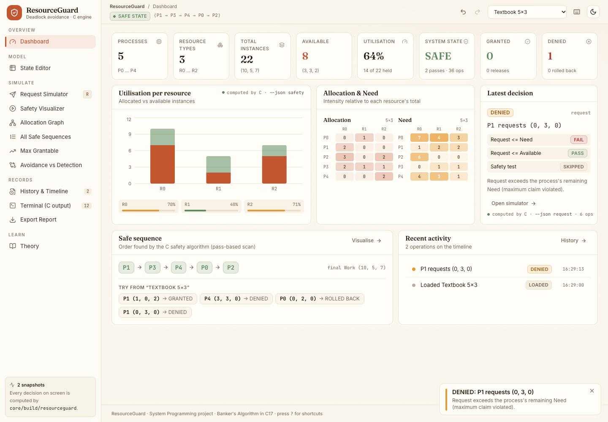
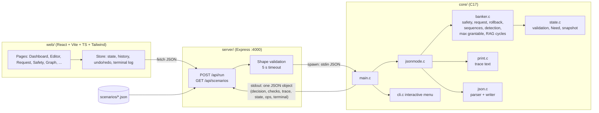
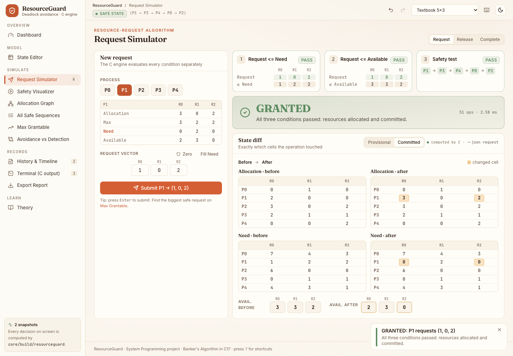
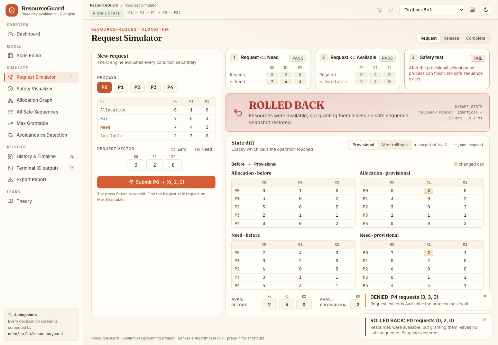
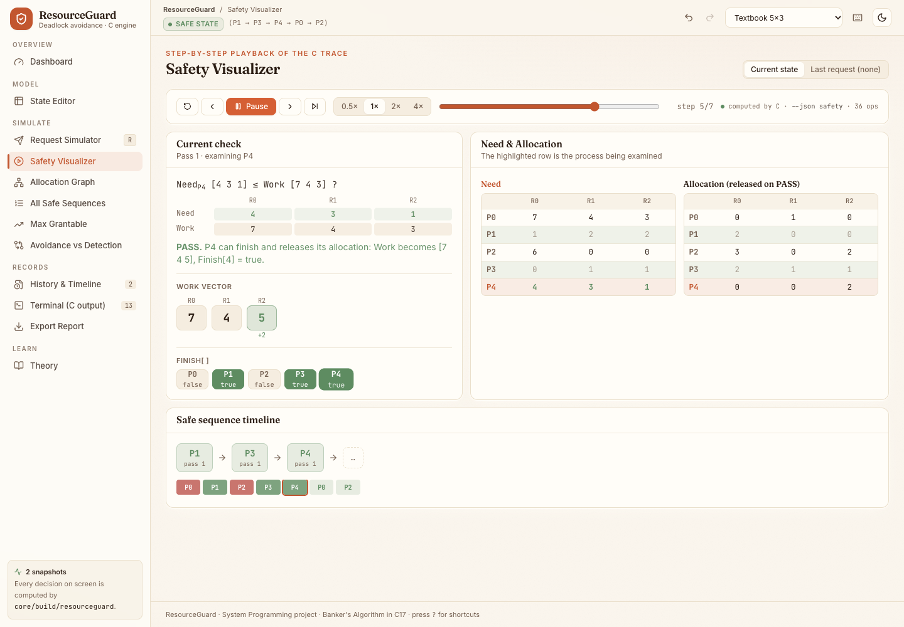
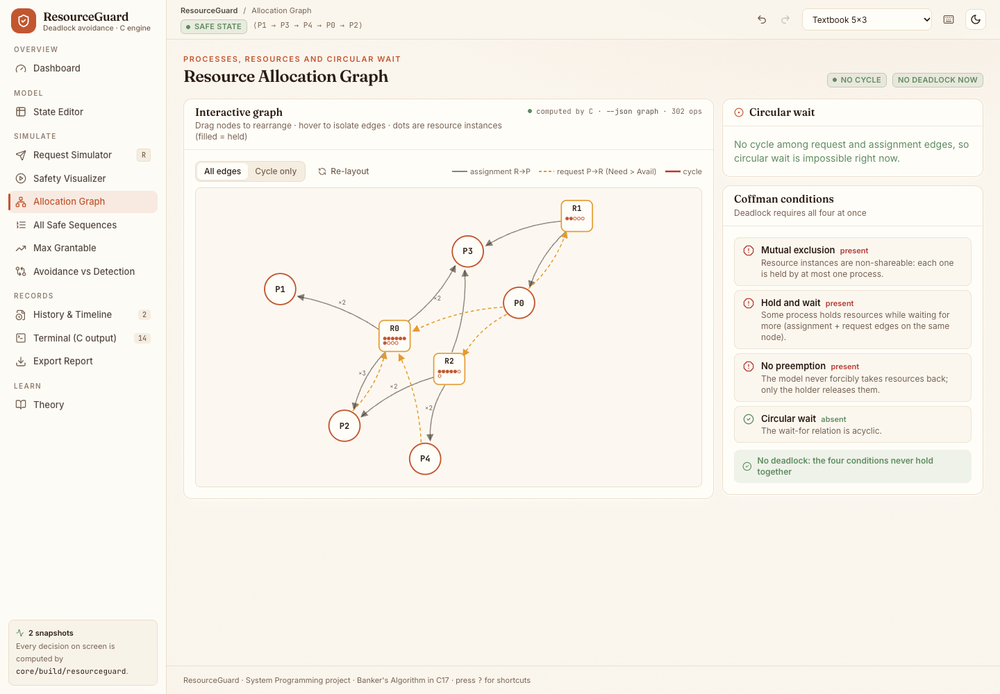
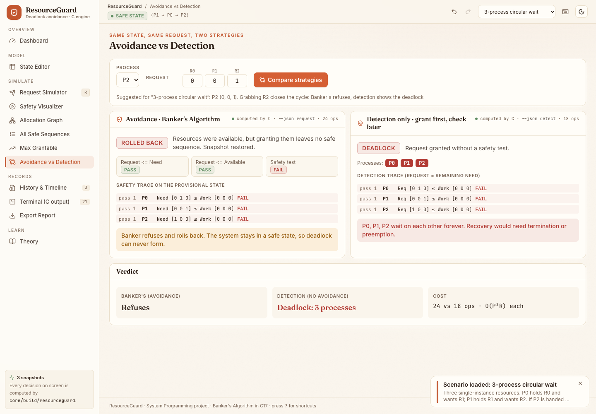
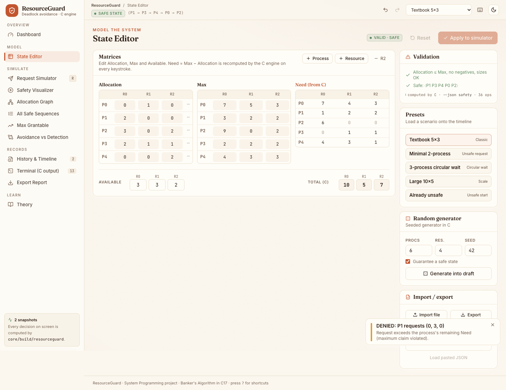
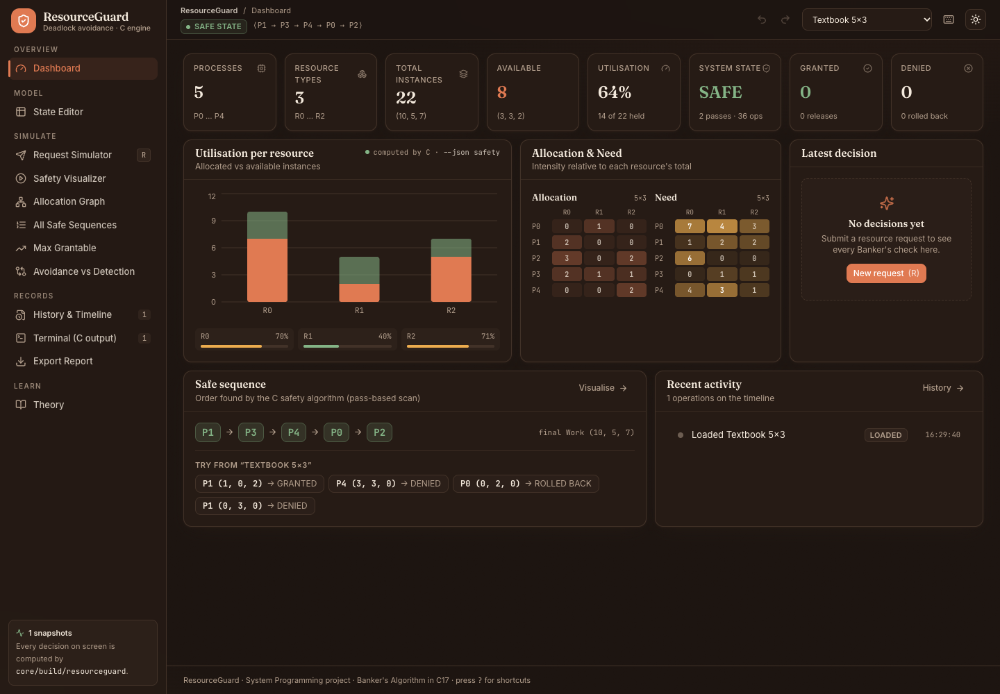
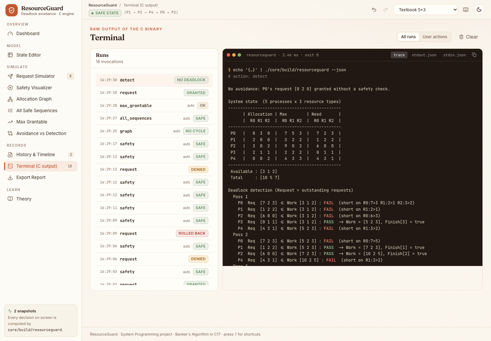

# ResourceGuard: C-Based Deadlock Avoidance Simulator

A System Programming course project. The **Banker's Algorithm** is implemented in **C17** (only `stdio.h`, `stdlib.h`, `string.h`, `stdbool.h`). A web dashboard visualises it.

> The dashboard never runs the algorithm in JavaScript. Every decision, check, trace step, safe sequence, Need value, deadlock and graph cycle on screen comes from the C binary `core/build/resourceguard --json`. The **Terminal** page shows each run's raw stdin and stdout.



---

## Quick start

```bash
./run.sh            # macOS / Linux
run.bat             # Windows (needs gcc from MinGW-w64 / MSYS2 and Node 18+)
```

`run.sh` does the following:
1. builds the C engine with `-std=c17 -Wall -Wextra -Werror -pedantic -O2`
2. runs the C unit tests (it aborts if any fail)
3. installs the server and web dependencies
4. builds the dashboard
5. starts everything and prints the URL: **http://localhost:4000**

Options: `./run.sh --dev` runs the Vite dev server with hot reload at http://localhost:5173, proxying `/api` to :4000. `PORT=4100 ./run.sh` uses another port.

Requirements: gcc or clang, make, Node.js 18+, npm.

### Live deployment (Vercel)

**https://resourceguard-one.vercel.app**

On Vercel there is no long-running server, so the build works like this (see `vercel.json` and `scripts/vercel-build.sh`):
1. Vercel's Linux build image compiles the C engine with GCC (still `-Werror`) and runs `make test`. A failing test fails the deploy.
2. The dashboard is built into `web/dist` and served as static files.
3. `api/run.js`, `api/scenarios.js` and `api/health.js` are serverless functions. They bundle the Linux `core/build/resourceguard` binary and spawn it per request through `server/engine.js`, the same code the Express server uses.

To redeploy, run `vercel deploy --prod` from the project root.

### The C program on its own

```bash
cd core
make                 # builds build/resourceguard
make test            # 63 checks, all must pass
./build/resourceguard                    # interactive coloured menu
./build/resourceguard --demo             # textbook walkthrough (test cases 1-4)
./build/resourceguard --load ../scenarios/textbook.json
echo '{"action":"safety","state":{...}}' | ./build/resourceguard --json
```

---

## Architecture



| Folder | Contents |
|---|---|
| `core/include`, `core/src` | `state.c` (State struct, validation, Need, snapshot/restore, file I/O), `banker.c` (all algorithms), `print.c` (tables and traces), `json.c` (hand-written JSON reader and writer), `jsonmode.c` (`--json` command interface), `cli.c` (menu), `main.c` |
| `core/tests/test_banker.c` | unit and stress tests (`make test`) |
| `server/` | `index.js` (Express API, spawns the binary), `smoke.js` (HTTP replay of test cases 2-5) |
| `web/` | dashboard: 12 pages in `src/pages`, shared UI in `src/components`, API and store in `src/lib` |
| `scenarios/` | 5 preset states |

### The JSON interface

Input on stdin:

```json
{ "action": "request",
  "state": { "allocation": [[0,1,0],...], "max": [[7,5,3],...], "available": [3,3,2] },
  "pid": 1, "request": [1,0,2] }
```

The `action` field is one of `safety`, `request`, `release`, `complete`, `all_sequences`, `detect` (optional `pid` and `request` to grant without avoidance, optional `request_matrix`), `max_grantable`, `graph`, `validate` or `random`.

The output is one JSON object containing:
- `decision` (`GRANTED`, `DENIED`, `ROLLED_BACK`, `SAFE`, `UNSAFE`, `DEADLOCK`, …) and `reason`
- `checks[]`, each with its own PASS/FAIL/SKIPPED status and the vectors compared
- `safety.steps[]`, the full pass-by-pass trace
- `state_before`, `provisional` and `state`
- `rollback_verified`, the memcmp result
- `ops` and `complexity`
- `terminal`, the same human-readable trace the CLI prints

Invalid input still returns JSON, with `ok: false` and a list of `errors`.

---

## The algorithm

**State.** `typedef struct { int P, R; int alloc[MAX_P][MAX_R], max[...], need[...], avail[MAX_R]; } State;` with `MAX_P = 20` and `MAX_R = 10`. `calculate_need()` sets Need = Max − Allocation. Before that it validates `0 ≤ Allocation ≤ Max`, no negative values and the dimension limits, and rejects an invalid state with messages such as `Allocation[P2][R0] = 10 exceeds Max = 9`.

**Safety algorithm (pass-based).**
```
Work ← Available; Finish[i] ← false
repeat                                  // one pass = scan i = 0..P−1
  for each i with !Finish[i]:
     record (pass, i, Need_i, Work, per-resource fail flags)
     if Need_i ≤ Work:  Work += Allocation_i; Finish[i] = true; append Pi
until a pass finds no eligible process
SAFE ⇔ every Finish[i] is true
```
On the textbook state this produces **P1 → P3 → P4 → P0 → P2** in 2 passes and 7 recorded checks.

**Resource request** `request_resources(pid, req)`:
1. `Request ≤ Need` is checked for every resource j. A failure gives **DENIED** (maximum claim exceeded).
2. `Request ≤ Available` is evaluated and reported separately. A failure gives **DENIED** (the process must wait).
3. The state is snapshotted, the request is allocated provisionally and `is_safe()` runs. If the state is SAFE the change is **committed (GRANTED)**. If it is UNSAFE, `rollback_state()` restores the snapshot (**ROLLED BACK**) and byte-equality is verified with `memcmp`. Debug builds (`-DRG_DEBUG`, used by `make test`) abort on a mismatch.

**Extras**
- `all_safe_sequences()`: backtracking, capped at 1000. From a safe state every runnable process keeps the state safe, so the search never dead-ends. An unsafe state is probed first and returns 0 immediately.
- `detect_deadlock()`: the detection algorithm. Finish starts true for processes holding nothing. It uses Request (by default the remaining Need, as the worst case).
- `max_grantable()`: the largest request per resource, plus a greedy combined vector. Safety is monotone in the request size, so it uses binary search.
- `find_graph_cycles()`: elementary cycles in the resource-allocation graph. A process→resource edge exists when Need > Available. A cycle must contain at least two processes.
- `random_state()`: seeded generator that can guarantee a safe state.

### Complexity

| Operation | Time | Space |
|---|---|---|
| Safety algorithm | **O(P² · R)** (≤ P passes × P processes × R) | **O(P · R)** |
| Resource request | O(R) + one safety run = O(P² · R) | O(P · R) snapshot |
| Detection | O(P² · R) | O(P · R) |
| All safe sequences | O(P! · P · R) worst case, capped | O(P) recursion |
| Max grantable | O(R · log V · P² · R) | O(P · R) |

Every C response includes an operation counter (`ops`), shown in the UI next to the P²R bound.

---

## Dashboard pages

| Page | What it shows |
|---|---|
| **Dashboard** | KPI tiles (processes, resources, totals, available, utilisation, safe/unsafe, granted vs denied), utilisation chart, Allocation and Need heatmaps, latest decision, safe sequence, activity feed |
| **State Editor** | editable grids. Need is recomputed live **by C**, and cells C rejects are highlighted. Add or remove processes and resources, presets, the C random generator, JSON import and export |
| **Request Simulator** | three animated check cards with the exact numbers compared, a GRANTED / DENIED / ROLLED BACK verdict, and a before → after diff (including the provisional state). Release and complete modes |
| **Safety Visualizer** | play, pause, step and speed controls for the C trace: Work vector, Finish[] chips, highlighted row, sequence timeline. Works on the current state or on the last request's provisional state |
| **Allocation Graph** | draggable force-layout SVG, instance dots, assignment and request edges, cycles in red with a circular-wait explanation, the Coffman conditions panel |
| **All Safe Sequences** | count and searchable list (prefix or in-order), first-position chart |
| **Max Grantable** | largest safe request per process, with a "Try it" button that pre-fills the simulator |
| **Avoidance vs Detection** | Banker's refuses the request; detection without avoidance grants it and finds the deadlock |
| **History & Timeline** | every operation with a snapshot, undo/redo, restore, animated replay |
| **Terminal** | the raw C output: trace text, stdout JSON and stdin JSON for every run |
| **Theory** | deadlock, the Coffman conditions, prevention/avoidance/detection, pseudocode, complexity |
| **Export** | PDF report (state, trace, decision, raw C output, history), JSON report, and a `.txt` state file for the CLI |

Shortcuts: **R** opens the request simulator, **S** runs the safety check, **⌘/Ctrl Z** undoes, **⇧⌘Z** redoes, **?** shows help. The warm light and dark themes persist between visits.

---

## Screenshots

| | |
|---|---|
|  |  |
|  |  |
|  |  |
|  |  |

---

## Test cases

The textbook 5×3 state (resources R0, R1, R2 = A, B, C):

| | Allocation | Max | Need |
|---|---|---|---|
| P0 | 0 1 0 | 7 5 3 | 7 4 3 |
| P1 | 2 0 0 | 3 2 2 | 1 2 2 |
| P2 | 3 0 2 | 9 0 2 | 6 0 0 |
| P3 | 2 1 1 | 2 2 2 | 0 1 1 |
| P4 | 0 0 2 | 4 3 3 | 4 3 1 |

Available = (3, 3, 2), Total = (10, 5, 7).

| # | Test | Expected | Result |
|---|---|---|---|
| 1 | initial state | SAFE, P1 → P3 → P4 → P0 → P2 | ✅ |
| 2 | P1 requests (1,0,2) | **GRANTED**, sequence P1 → P3 → P4 → P0 → P2, Available becomes (2,3,0) | ✅ |
| 3 | then P4 requests (3,3,0) | **DENIED**: Request ≤ Need passes, Request ≤ Available fails on R0 (3 > 2) | ✅ |
| 4 | then P0 requests (0,2,0) | both checks pass, provisional state is unsafe, **ROLLED BACK**, `memcmp(state, snapshot) == 0` | ✅ |
| 5 | P1 requests (0,3,0) on the initial state | **DENIED**: Request > Need on R1 (3 > 2) | ✅ |
| 6 | invalid input | Allocation > Max, negative values, pid out of range, over-release, bad dimensions: all rejected | ✅ |
| 7 | stress test | 1000 random safe states × 25 requests: no committed state is ever unsafe, and every denial leaves the state byte-identical | ✅ |
| + | extras | sequence enumeration is valid, detection finds the 3-process deadlock, the RAG cycle P0 R1 P1 R2 P2 R0, max grantable is maximal | ✅ |

```
$ make -C core test
...
63 passed, 0 failed
```

The same cases were replayed over HTTP (`node server/smoke.js`) and through the real UI in headless Chrome. The dashboard showed GRANTED, DENIED, ROLLED BACK and DENIED with the same checks, no console errors, and no horizontal overflow at 390 px.

### Presets (`scenarios/`)
- **Textbook 5×3**: the classic example above, with test-case shortcuts.
- **Minimal 2-process**: safe, but P0 requesting (1,0) is available and unsafe, so it is rolled back.
- **3-process circular wait**: three single-instance resources. P2 grabbing R2 closes the cycle P0→R1→P1→R2→P2→R0.
- **Large 10×5**: generated by the C engine's seeded generator.
- **Already unsafe**: the textbook matrices with Available = (1,1,1). P3 and P1 can finish, then everything is stuck.
